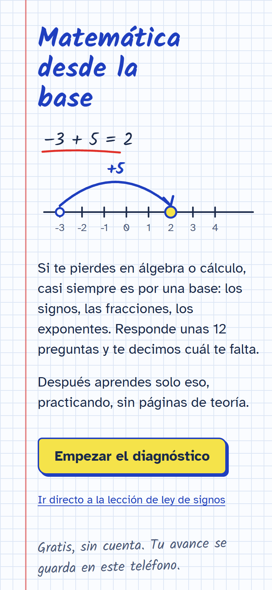
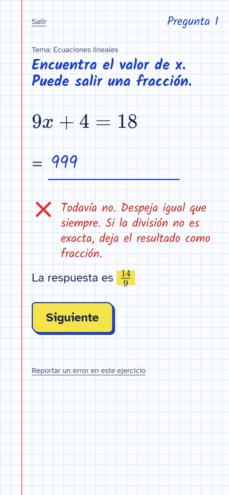
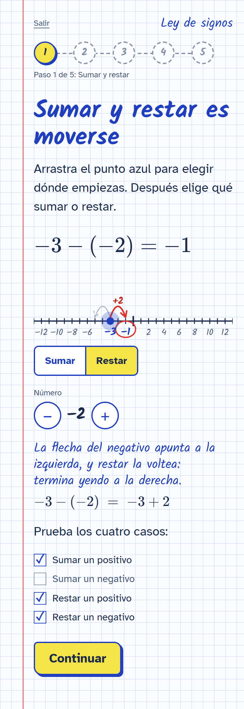
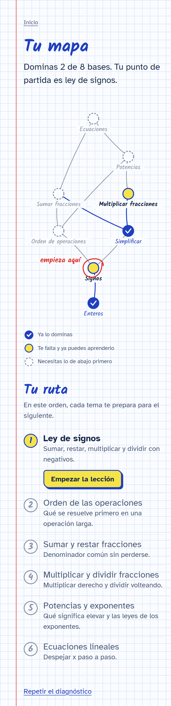
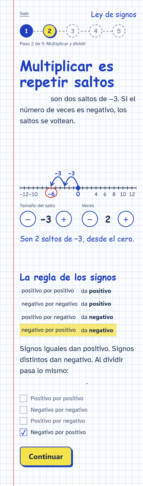

# Desde la base

Plataforma web gratuita para aprender matemática desde la base, pensada para estudiantes de Guatemala y Latinoamérica.

Muchos estudiantes se pierden en álgebra o cálculo por una base que les falta: los signos, las fracciones o los exponentes. Aquí un diagnóstico corto encuentra cuál es y arma una ruta para aprender solo eso, practicando.

- **Sin IA y sin APIs de pago.** Los ejercicios, la revisión de respuestas y la explicación de cada error son deterministas.
- **Sin cuentas.** El avance se guarda en el navegador.
- **Pensada para el teléfono.** Funciona con datos limitados y se publica como sitio estático.

<p>
  
  
  
</p>

> Estado: **fase 1 (prototipo)**. Incluye el diagnóstico completo y una lección, la de ley de signos.

## Qué puedes hacer

### 1. Diagnóstico adaptativo

Son unas 10 a 12 preguntas, como máximo 12. No sigue una lista fija: recorre el mapa de conceptos.

- Si fallas un tema, baja a lo que ese tema necesita.
- Si lo dominas, da por dominado lo que está debajo y sube.
- El botón **No sé** también cuenta: le dice al diagnóstico por dónde seguir.

### 2. Tu mapa y tu ruta

El resultado se ve como un mapa dibujado en el cuaderno, en tres colores:

- lo que dominas;
- lo que ya puedes aprender;
- lo que necesita algo de abajo primero.

Debajo del mapa está la ruta: los temas en el orden en que conviene aprenderlos.

<p>
  
</p>

### 3. Lección de ley de signos

La lección tiene cinco pasos, y cada paso desbloquea el siguiente.

1. **Sumar y restar es moverse.** Arrastras el punto de inicio sobre la recta. El signo menos voltea la flecha y queda la marca de lápiz de cómo iba antes.
2. **Multiplicar es repetir saltos.** (−3)·2 son dos saltos de −3, y si las veces son negativas los saltos se voltean. Al lado se resalta la fila de la tabla de signos que estás usando.
3. **Ejemplo guiado.** Se resuelve paso a paso eligiendo opciones. Si eliges mal, te explica por qué.
4. **Práctica.** Los ejercicios se generan con números nuevos cada vez. Si fallas una suma o una resta, ves el recorrido en la recta.
5. **Mini prueba.** Con 5 de 6 bien queda dominada y se desbloquean los temas que siguen.

<p>
  
</p>

### 4. Explicaciones sin IA

Cuando una respuesta está mal, la app no dice solo "incorrecto": busca qué error común da exactamente ese resultado. Por ejemplo:

- sumar los denominadores de dos fracciones;
- olvidar que menos por menos da más;
- resolver la suma antes que la multiplicación.

Así puede decirte en qué te equivocaste.

## Cómo funciona por dentro

```
src/
├─ engine/        Motor matemático
│                   · fracciones exactas
│                   · lector de respuestas
│                   · RNG con semilla
│                   · verificador
├─ content/       Mapa de conceptos y generadores de ejercicios por tema
├─ diagnostic/    Máquina del diagnóstico adaptativo
├─ lessons/       Lógica de las lecciones; cada lección en su carpeta, con su contenido aparte
├─ storage/       Progreso versionado en localStorage
├─ screens/       Pantallas: inicio, diagnóstico, resultado y lección
├─ ui/            Componentes: teclado, recta numérica, mapa, fórmula…
└─ config/        Lo que se cambia sin tocar código: formularios externos
```

- **Fracciones exactas.** Ninguna cuenta usa decimales de punto flotante: 1/3 + 1/6 da exactamente 1/2. El verificador compara el valor exacto y aparte revisa si la respuesta quedó simplificada.
- **Ejercicios con semilla.** Cada ejercicio sale de un generador con semilla, así que el mismo número produce siempre el mismo ejercicio. Por eso un reporte de error incluye la semilla: con ella se puede reproducir el caso exacto.
- **Errores como datos.** Cada generador calcula, además de la respuesta correcta, los valores que darían los errores comunes, cada uno con su explicación. Revisar una respuesta es buscar cuál de esos valores coincide.
- **Mapa de conceptos como datos.** Los temas y sus prerrequisitos están en [`src/content/concepts.ts`](src/content/concepts.ts). El diagnóstico, el mapa y la ruta salen de ahí: para agregar un tema basta con agregarlo al archivo.
- **Progreso con versión.** Lo guardado se valida al leerlo y tiene número de versión para migrarlo. Si el navegador bloquea `localStorage`, la app sigue funcionando sin guardar.
- **Recta numérica.** Está hecha con [Mafs](https://mafs.dev). Toda operación se describe como una fila de saltos que un signo menos voltea ([`saltos.ts`](src/lessons/ley-de-signos/saltos.ts)). GSAP anima la secuencia y un lector de pantalla recibe la misma operación en palabras.

### Tecnologías

| | |
|---|---|
| Interfaz | React 19, TypeScript estricto, Vite |
| Matemática | Mafs (recta interactiva), KaTeX (fórmulas) |
| Animación | Motion (interfaz) y GSAP (secuencias del mapa y la recta) |
| Pruebas | Vitest: motor, generadores, diagnóstico, progreso y lección |
| Calidad | oxlint |

### Accesibilidad y peso

- Todo se puede usar con teclado y tiene etiquetas para lectores de pantalla.
- Si el sistema pide menos movimiento (`prefers-reduced-motion`), las animaciones muestran directo el estado final.
- Las fuentes, Kalam y Atkinson Hyperlegible, van incluidas en el sitio: no se cargan de servicios externos.
- La lección y el diagnóstico se descargan solo cuando los abres.

## Correr el proyecto

Necesitas Node 22.12 o más reciente.

```bash
npm install
npm run dev      # servidor local en http://localhost:5173
npm test         # pruebas
npm run lint     # revisión de código
npm run build    # sitio estático en dist/
```

## Publicar

El build es un sitio estático con rutas por hash (`#/diagnostico`), así que no necesita configurar redirecciones.

### Vercel

Importa el repositorio en Vercel. [`vercel.json`](vercel.json) ya trae el comando de build, la carpeta `dist` y caché largo para los archivos con hash.

### GitHub Pages

1. Sube el repositorio a GitHub.
2. En **Settings → Pages**, elige **Source: GitHub Actions**.
3. En **Actions**, corre **Publicar en GitHub Pages** ([`pages.yml`](.github/workflows/pages.yml)): revisa el código, corre las pruebas y publica. Por ahora se corre a mano; para publicar en cada push a `main`, agrega ese disparador al workflow.

Como el build usa rutas relativas, funciona igual en `usuario.github.io/repositorio/`.

## Configurar los formularios

Los botones **Reportar un error** y **Sugerencias** abren formularios externos (Tally o Google Forms). Pon sus enlaces en [`src/config/site.ts`](src/config/site.ts); el archivo explica cómo hacerlo.

El reporte llena solo estos campos:

- el tema;
- el ejercicio;
- la semilla;
- lo que respondió la persona.

No envía datos personales.

## Próximas fases

- **Fase 2:** las lecciones de todas las bases y exportar o importar el progreso con un código. La función ya existe en `src/storage/schema.ts`; falta la pantalla.
- **Fase 3:** un simulacro cronometrado del examen de admisión de la USAC y uso sin internet (PWA).
- **Fase 4:** precálculo, trigonometría, álgebra lineal y cálculo.

## Autor

Hecho por Mynor Arias.
